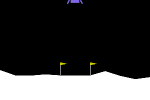
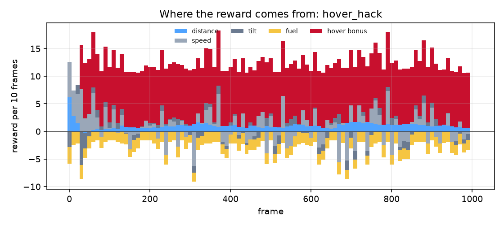
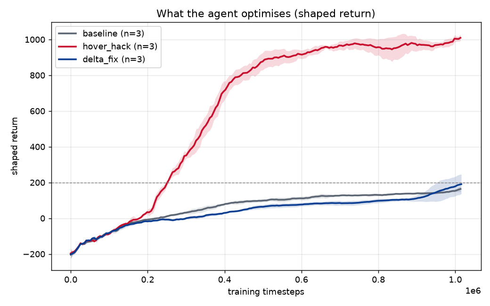
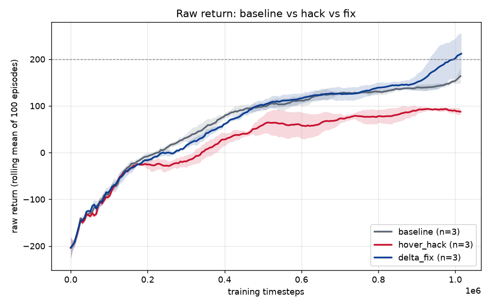
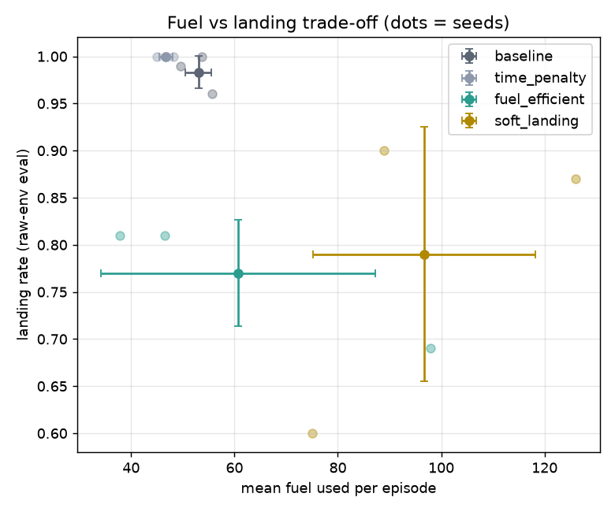
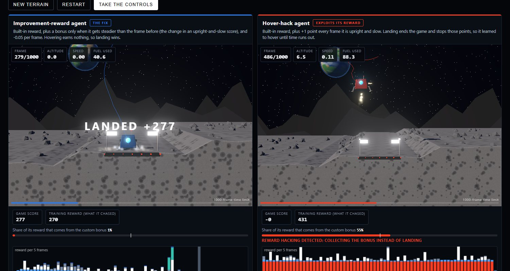
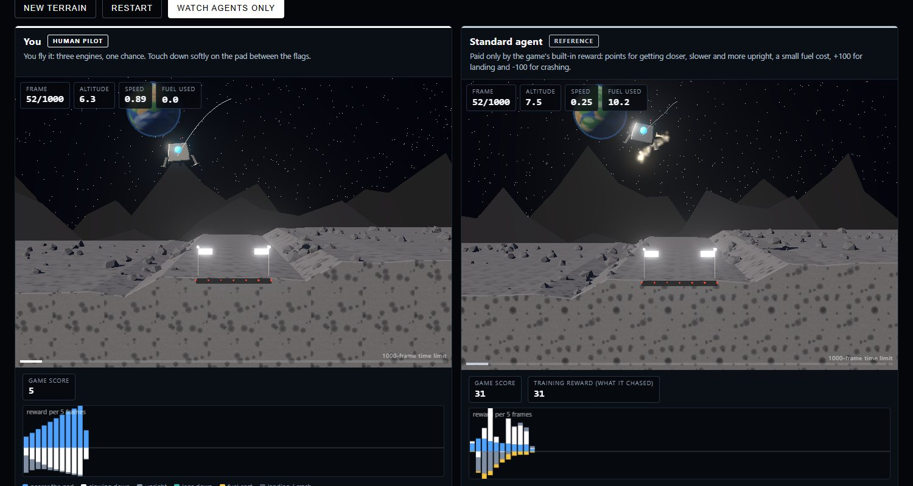

# Lunar Lander Reward Shaping & Reward Hacking trained with PPO Algorithm

[](https://huggingface.co/spaces/Vedant117/Reward-Shaping-project)


> **Live demo and write-up: <https://huggingface.co/spaces/Vedant117/Reward-Shaping-project>**
> A research-style summary of the results, plus a 3D simulator where you can fly against the trained agents.

A naive per-frame shaping bonus taught a PPO agent to **hover until timeout instead of landing**
(299 of 300 evaluation episodes timed out, 1 landed). An improvement-based (potential) reward fixed it:
**99% landing, under 1% timeouts**, across 3 seeds. A numeric detector flags the hacked runs and none of the
healthy ones, and the whole thing ships as a small pip-installable library plus an in-browser 3D demo.

| Hover hack (naive bonus) | Fix (improvement-based) | Baseline |
|---|---|---|
|  |  |  |

**Contents:** [Key numbers](#key-numbers) · [Results](#results) · [Findings](#findings) ·
[Algorithm swap (DQN)](#algorithm-swap-dqn) · [3D demo](#3d-demo-web) · [Reproduce](#reproduce) ·
[Library](#library) · [Layout](#layout) · [Limitations](#limitations)

## Key numbers

| | |
|---|---|
| Hacked agent (+1 per frame for hovering) | 299 / 300 evaluation episodes hit the 1,000-frame limit, 1 landed, true return -78 ± 22 |
| Improvement-based fix | 99% landing, under 1% timeouts, return 258 ± 7 (baseline: 98%, 256 ± 3) |
| Training reward of the hacked agent | climbs to about 1,000 while the true score stays low |
| Detector | flagged 6 / 6 hacked PPO runs, 0 / 18 healthy PPO runs |
| Scope | 8 reward designs × 3 seeds with PPO (24 runs), plus 2 designs × 3 seeds with DQN |
| Evaluation | raw environment reward only, 100 deterministic episodes per seed, evaluation seeds disjoint from training seeds |

## The idea in one minute

The reward function is the only thing that tells an agent what you want. In Lunar Lander the episode is cut
off after 1,000 frames and *landing ends the episode*, which also ends any per-frame payment. A bonus of +1
per frame for being upright and slow therefore out-earns a safe landing, and PPO finds it. The fix pays the
*change* in an upright-and-slow score (potential-based shaping, `F = γΦ(s') − Φ(s)`, Ng et al. 1999), which
telescopes over an episode, so there is nothing to farm by waiting.


*Per-frame reward of the hacked agent over one 1,000-frame episode: the red bonus term dwarfs everything the
environment pays.*


*What the agents optimise (training reward including the bonus): the hacked agent's reward soars while it
never lands.*

## Results

PPO, `LunarLander-v3`, 3 training seeds (0-2), 1M steps (500k for the last two rows).
**All numbers are from the raw environment reward**, 100 deterministic episodes per seed, evaluation
seeds (10000+) disjoint from training seeds. Mean ± std across seeds.

| Variant | Seeds | Return | Landing | Crash | Timeout | Ep. length | Fuel | Steps to 150 (train) | Hack flag |
|---|---|---|---|---|---|---|---|---|---|
| baseline | 3 | 256 ± 3 | 0.98 ± 0.02 | 0.00 ± 0.00 | 0.02 ± 0.02 | 365 ± 17 | 53 ± 3 | 965k ± 32k (3/3) | 0/3 |
| time_penalty | 3 | 265 ± 1 | 1.00 ± 0.00 | 0.00 ± 0.00 | 0.00 ± 0.00 | 305 ± 7 | 47 ± 1 | 744k ± 75k (3/3) | 0/3 |
| **hover_hack** | 3 | -78 ± 22 | 0.00 ± 0.00 | 0.00 ± 0.00 | **1.00 ± 0.00** | 1000 ± 0 | 184 ± 0 | never (0/3) | **3/3** |
| **delta_fix** | 3 | 258 ± 7 | 0.99 ± 0.00 | 0.00 ± 0.00 | 0.00 ± 0.00 | 347 ± 33 | 51 ± 6 | 868k ± 68k (3/3) | 0/3 |
| delta_no_time | 3 | 266 ± 3 | 0.99 ± 0.01 | 0.01 ± 0.01 | 0.00 ± 0.00 | 279 ± 14 | 41 ± 3 | 649k ± 40k (3/3) | 0/3 |
| tilt_only_hack | 3 | -64 ± 23 | 0.00 ± 0.00 | 0.00 ± 0.00 | 1.00 ± 0.00 | 997 ± 4 | 184 ± 1 | never (0/3) | 3/3 |
| fuel_efficient* | 3 | 179 ± 38 | 0.77 ± 0.06 | 0.14 ± 0.02 | 0.09 ± 0.04 | 427 ± 132 | 61 ± 27 | never (0/3) | 0/3 |
| soft_landing* | 3 | 167 ± 21 | 0.79 ± 0.13 | 0.08 ± 0.04 | 0.13 ± 0.10 | 621 ± 78 | 97 ± 22 | never (0/3) | 0/3 |

Rates are rounded: `hover_hack` and `tilt_only_hack` each timed out in 299 of 300 evaluation episodes.
\* trained for 500k steps only, so not directly comparable with the 1M-step rows.
"Steps to 150" is the first training step where the rolling-100 *training* return (stochastic policy)
reaches 150; training returns sit below deterministic evaluation, so 200 is rarely reached there.
Full tables: [`results/ablation.csv`](results/ablation.csv), [`results/per_seed.csv`](results/per_seed.csv).

What each design adds to the built-in reward:

| Variant | Added reward |
|---|---|
| `baseline` | nothing |
| `time_penalty` | -0.05 every frame |
| `hover_hack` | +1 every frame the lander is upright and slow |
| `delta_fix` | 10 × the per-frame improvement in an upright-and-slow score, and -0.05 per frame |
| `delta_no_time` | same improvement term, no per-frame cost |
| `tilt_only_hack` | +1 every frame the lander is level, ignoring position and speed |
| `fuel_efficient` | fuel cost doubled |
| `soft_landing` | penalty on touchdown speed and tilt |




## Findings

- **The hack is reliable.** `hover_hack` hovered to the 1000-frame timeout in 3/3 seeds. Its deterministic
  policy fires the engine for ~184 fuel and collects the bonus rather than landing. The raw training return still
  climbs to ~90 because the *stochastic* policy sometimes lands by accident; the deterministic policy is what
  hovers. The score alone would not have shown the failure; timeout rate and clips do.
- **The fix works.** `delta_fix` matches the baseline: 99% landing, under 1% timeouts, similar fuel. The shaping
  telescopes, so hovering earns nothing.
- **The delta structure matters; the time penalty did not (here).** `delta_no_time` landed as reliably as
  `delta_fix`, so the improvement-based form is what removes the exploit. `time_penalty` alone also helped
  slightly (shorter, cheaper landings).
- **The failure generalises.** `tilt_only_hack` (bonus for low tilt only) failed the same way: 299 of 300
  episodes timed out. Hovering upright is the cheapest way to farm any per-frame state bonus.
- **Detector.** An alert needs timeout rate > 30% *and* bonus share of the reward > 50% (configurable). It fired
  on all 3 seeds of both hacks and none of the 18 other runs. Requiring both conditions matters: a baseline that
  merely stalls early in training has timeouts but no bonus share. During training the callback warned around
  0.5-0.65M steps for `hover_hack`.
- **Trade-offs.** Doubling fuel cost (`fuel_efficient`) and a touchdown penalty (`soft_landing`) both lowered
  landing rate at 500k steps, and landings are often *off the pad* (on-pad rate 0.45 and 0.66, vs 0.98 for the
  baseline; see `on_pad_rate` in `results/per_seed.csv`). "Landed" means the environment's +100 (lander at
  rest), not necessarily on the pad.

## Algorithm swap: DQN

Same rewards, DQN instead of PPO (500k steps, 3 seeds, hyper-parameters from the common RL-Zoo setting, not
tuned). Raw-env evaluation, 100 episodes per seed.

| Variant | Return | Landing | Crash | Timeout | Ep. length | Hack flag |
|---|---|---|---|---|---|---|
| hover_hack (DQN) | -231 ± 375 | 0.27 ± 0.28 | 0.50 ± 0.35 | 0.23 ± 0.28 | 413 ± 251 | 1/3 |
| delta_fix (DQN) | 166 ± 29 | 0.75 ± 0.10 | 0.21 ± 0.09 | 0.04 ± 0.04 | 369 ± 177 | 0/3 |

Per seed, `hover_hack`: seed 0 hovers (63% timeouts, bonus share 0.50, flagged), seed 1 diverged into constant
crashes (return -750), seed 2 mostly lands (66%, timeout 6%). **Reading:** the hack is not PPO-only (one DQN seed
shows the same hovering and the detector flags it), but it is far less consistent than under PPO, and DQN is a
weaker, less stable learner here (even `delta_fix` lands only 75%). With an untuned 500k-step DQN and 3 seeds this
is suggestive, not conclusive. Files: [`results/ablation_dqn.md`](results/ablation_dqn.md).

## 3D demo (`web/`)

**Try it:** <https://huggingface.co/spaces/Vedant117/Reward-Shaping-project>

A static site (no server): a research-style overview with the results, and a simulator where you can fly the
lander yourself against any trained agent or watch the hover-hack agent next to the delta-fix agent on identical
terrain. Each panel has a live stacked reward-breakdown chart and the detector's bonus-share meter; wind (calm /
breeze / storm) can be switched on.




- **Physics:** a port of Gymnasium's `LunarLander-v3` to JavaScript (planck.js, a Box2D port). Terrain RNG differs
  from numpy, so episodes are not seed-identical to Python, but behaviour is: exported policies in the port give
  baseline and delta_fix 100% landing and hover_hack 100% timeouts on 40 episodes (`web/tests/fidelity.mjs`), and the
  JS forward pass matches SB3's action on 400/400 recorded observations (`web/tests/parity.mjs`).
- **Policies:** the real seed-0 PPO networks exported as JSON by `scripts/export_policies.py`.
- **Playing it:** the real game is hard for humans (a 13 m free fall in about 1.5 s; any hull contact is a crash), so
  *your* lander has Easy / Medium / Real difficulty. Easy = half speed, low gravity, auto-level and bouncy side walls;
  Medium = 0.75× speed, lower gravity, auto-level, side walls; Real = exactly what the agents fly. The agents never
  get the handicaps. A latency-limited scripted pilot (`web/tests/human_sim.mjs`) lands about 90% on Easy and 80% on
  Medium (10 episodes each, indicative only) and crashes on Real.
- **Rendering:** Three.js with shadows, bloom, particle exhaust and dust, and a trail line that shows the hover loop.
- **Wind robustness** (browser port, seed-0 policies, 60 episodes each): landing under breeze was baseline 0.97,
  delta_fix 0.92, time_penalty 0.97; under storm baseline 0.42, delta_fix 0.43, delta_no_time 0.53, time_penalty
  0.67. The fix is about as robust as the baseline; all policies degrade in a storm because none was trained with
  wind. One seed and 60 episodes: indicative only.

**Run locally:** `python -m http.server -d web 8000` then open <http://localhost:8000>.
**Tests:** `cd web && npm install && npm test`. `node tests/shot.mjs` drives headless Chrome for screenshots.

**Redeploy the Space:** `python scripts/build_space.py` assembles a clean `dist/space/` folder, then either upload
its contents in the Space's *Files* tab, or run
`hf upload Vedant117/Reward-Shaping-project dist/space . --repo-type=space` after `hf auth login`.

## Reproduce

```bash
python -m venv .venv && .venv/Scripts/activate      # or source .venv/bin/activate
pip install -e ".[dev]"               # needs swig if Box2D fails to build
python scripts/00_install_check.py
python scripts/01_random_agent.py     # random policy: ~ -210 return
python scripts/run_all.py             # all variants x seeds (about 20-40 min with 16 cores)
python scripts/run_all.py --algo dqn --variants hover_hack delta_fix --steps 500000   # ~1.5 h
python -m rewardlab.analysis          # results/ tables + plots
python scripts/make_gifs.py           # GIFs + breakdown JSON
python scripts/export_policies.py     # policies + results -> web/
python -m http.server -d web 8000     # site at http://localhost:8000
pytest -q
```
One run: `python -m rewardlab.train --variant hover_hack --seed 0`. TensorBoard: `tensorboard --logdir runs`
(detector metrics under `hack/`). Pinned versions are in `requirements.txt`. `make smoke` runs 20k-step runs for
every variant. A baseline 1M-step run took about 19.5 minutes single-threaded (9 in parallel).
Every run is defined by (variant, seed, config); evaluation seeds differ from training seeds.

## Library

```python
import gymnasium as gym
from stable_baselines3 import PPO
from rewardlab import RewardShapingWrapper, HackingCallback, make_reward_fn

env = RewardShapingWrapper(gym.make("LunarLander-v3"), make_reward_fn("hover_hack"))
model = PPO("MlpPolicy", env)
model.learn(100_000, callback=HackingCallback(episodes_path="episodes.csv"))
```
Any callable `reward_fn(obs, action, reward, terminated, truncated) -> (extra, {term: value})` works. The wrapper
never changes observations or termination (unit-tested) and always exposes `info["raw_reward"]` and
`info["reward_terms"]`. `HackingDetector.analyze(df)` runs the same metrics on an evaluation log.

## Layout

| Path | What |
|---|---|
| `src/rewardlab/` | the library: wrapper and variants, detector, env helpers, train / evaluate / record / analysis |
| `configs/` | PPO hyper-parameters, reward variants |
| `scripts/` | runnable steps (sweep, GIFs, policy export, Space build) |
| `web/` | the static site: research overview, 3D simulator, vendored Three.js and planck.js |
| `results/` | committed tables, figures and GIFs |
| `tests/` | wrapper and detector tests (21) |
| [`lunar_lander_reward_shaping_project.md`](lunar_lander_reward_shaping_project.md) | the original project spec |

## Limitations

- Three seeds per design: standard deviations are small, but this is an engineering study, not a statistical one.
- One environment, hand-picked bonus magnitudes, and an untuned DQN. The DQN and wind results are indicative.
- "Steps to 150" uses stochastic training returns, which sit below deterministic evaluation, so it is not a
  headline number.
- The browser simulator is a behavioural port of the environment, not bit-identical to the Python run; all headline
  numbers come from the Python evaluation.

## References

Ng, Harada & Russell (1999), *Policy invariance under reward transformations*. Schulman et al. (2017), *Proximal
Policy Optimization Algorithms*. Mnih et al. (2015), *Human-level control through deep reinforcement learning*.
Gymnasium `LunarLander-v3`; Stable-Baselines3.

## License

MIT, see [`LICENSE`](LICENSE). Built by Vedant Pandhare.
